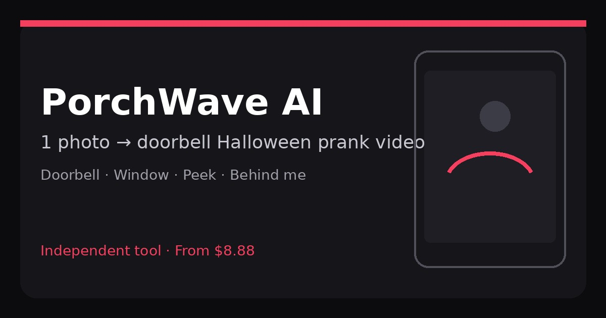

# PorchWave AI

  

  <strong>1 photo → ~10s doorbell-cam Halloween PorchWave AI prank short</strong>

  
  

Independent fan / Halloween joke tool. **Not a real sighting.** Not affiliated with original meme creators or any third-party brand / PorchWave rights holders.

## Links

| | URL |
|---|---|
| **App** | https://catinthehat.cc |
| **www** | https://www.catinthehat.cc |
| **Fallback** | https://catinthehat.chatgpt-plus.workers.dev |
| **This landing** | https://xianyu110.github.io/catinthehat-ai/ |

## Versions

| Version | Output | Credits (approx.) |
|---------|--------|-------------------|
| Doorbell | ~10s · 1080p + scene still · one-click | ~56 |
| Window | ~10s · 1080p + scene still · one-click | ~56 |
| Peek | 2K · 9:16 still · one-click | ~3 |
| Behind me | 2K · 9:16 still · one-click | ~3 |

Exact price shown on the create button before you generate. Failed runs refund credits. USD credit packs: see on-site pricing / checkout (not hard-coded on this landing).

## What it does

Upload one photo (porch, window, room, or selfie) → get a doorbell-camera Halloween prank short (or still). Four looks: Doorbell / Window / Peek / Behind me. Create on catinthehat.cc.

## Safety

- Label AI-generated content when you share
- No real addresses, schools, or names
- No threats — keep it a joke among people who get the meme
- Never use this to scare children

## Disclaimer

Independent fan / Halloween joke tool on https://catinthehat.cc. Not a real sighting. Not affiliated with original meme creators or any third-party brand / PorchWave rights holders. Page uses abstract CSS silhouettes only.
